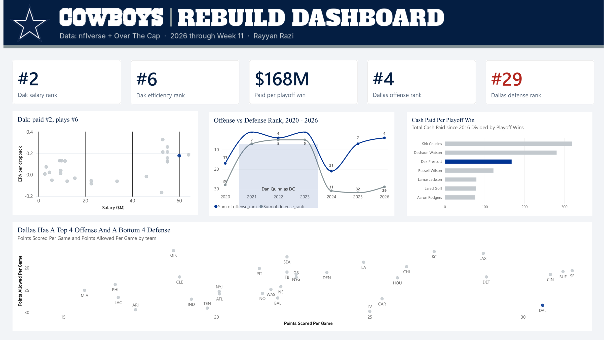

# Cowboys Rebuild Plan: A Data-Backed Case for a New Identity

I'm not a Cowboys fan, but I live in DFW, so I hear about them every day. After a debate with a friend, I wrote out a 4-step plan to fix the team, then tested every take with real NFL data.

## The 4 takes

| Take | Key finding |
|---|---|
| **1. Trade Dak** | #6 in EPA per dropback but #2 in salary ($60M, 23.5% of the cap). 2-5 in the playoffs since 2016, which works out to $168M paid per playoff win. |
| **2. Hire a defensive head coach** | 16 straight years of offensive head coaches. With Dan Quinn as DC (2021-23) the defense ranked 7th, 5th, 5th. The year he left it fell to 31st. 15 of the last 16 Super Bowl champs had a top-half defense. |
| **3. Keep CeeDee, trade Pickens** | Dallas can't pay two WRs $30M+ while fixing the defense. Comparable tag-and-trade deals (Metcalf, Ngakoue, Ford, Diggs) returned a 2nd-round pick. |
| **4. Build the defense with prove-it vets** | Dallas is a top-4 offense with a bottom-4 defense. Cheap vets like Andrew Van Ginkel, Kyle Van Noy, Rasul Douglas, and Jadeveon Clowney have produced big seasons on small deals. |

## How I built it

1. **Data:** NFL player stats, schedules, contracts, and trades from [nflverse](https://github.com/nflverse) and Over The Cap, pulled with Python (`nflreadpy`) in Google Colab.
2. **Analysis:** EPA per dropback, cash paid per playoff win, offense and defense ranks by points per game, coach hire outcomes, and comparable trade returns.
3. **Dashboard:** built in Power BI using DAX measures and conditional formatting.

## What's in this repo

| Folder / file | Contents |
|---|---|
| `Cowboys_Rebuild_Analysis.ipynb` | Full analysis code. Runs top to bottom in Google Colab. |
| `data/` | Clean CSVs used in the Power BI dashboard |
| `charts/` | Charts generated by the notebook |
| `dashboard/` | Power BI dashboard (image + .pbix file) |
| `Cowboys_Rebuild_Carousel.pdf` | The LinkedIn carousel |

## Notes

- 2026 numbers are through Week 11.
- Coach backgrounds (offense vs. defense) and defensive coordinators were classified manually.
- Cash per playoff win = total cash paid 2016-2026 divided by playoff wins in that span.

Built by Rayyan Razi. [LinkedIn](https://www.linkedin.com/in/rayyan-razi1/)
